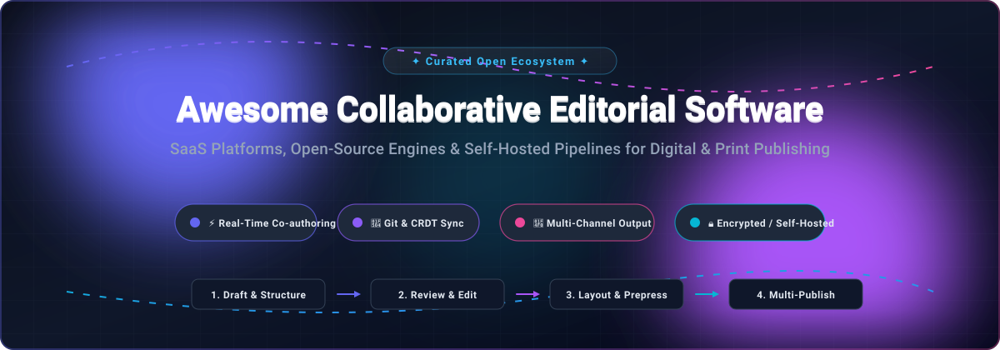

  

  
  
  
  
  
  

# 📝 Awesome Collaborative Editorial Software

> 🚀 **A curated directory of top SaaS platforms, open-source engines, and self-hosted workflows for collaborative authoring, multi-channel digital publishing, and prepress copy editing.**

*Last updated: October 2026*

---

Welcome to the definitive ecosystem guide for **Collaborative Editorial Software**. Modern digital publications, magazine newsrooms, corporate communication teams, and academic organizations require sophisticated software to write, review, cross-edit, track revisions, and approve documents in parallel across distributed teams. 

Whether your workflow demands tight **Adobe InDesign & ICML layout synchronizations**, multi-tenant **headless CMS pipelines**, **Git-backed cryptographic editorial audit trails**, or **CRDT/WebSocket real-time collaborative document pads**, this repository organizes the landscape into curated commercial leaders and actively maintained open-source solutions.

---

## 📑 Table of Contents

- [📊 Sector Overview & Market Dynamics](#-sector-overview--market-dynamics)
- [🏢 SaaS & Hosted Commercial Platforms](#-saas--hosted-commercial-platforms)
- [💻 Open-Source & Self-Hosted Projects](#-open-source--self-hosted-projects)
  - [Top Open-Source Software (Ranked by Stars)](#top-open-source-software-ranked-by-stars)
  - [Specialized Ecosystem & Workflow Tools](#specialized-ecosystem--workflow-tools)
- [📈 Star History](#-star-history)
- [💖 Support & Sponsorship](#-support--sponsorship)
- [🤝 How to Contribute](#-how-to-contribute)
- [⚖️ Disclaimer & Architecture Guidance](#️-disclaimer--architecture-guidance)

---

## 📊 Sector Overview & Market Dynamics

The global collaborative authoring and digital publishing workflow software market is estimated at approximately **$2.9B to $3.4B** (projected to reach over **$8.8B+** by the early 2030s at an ~12–13% CAGR). The sector is **moderately fragmented**: mega-cap creative giants (notably Adobe) capture dominant mindshare and standard file formats, while a diverse tier of specialized publishing lifecycle providers (WoodWing, Bynder/GatherContent, Quark, and vjoon) compete across enterprise multi-channel publishing and custom compliance workflows alongside emerging open-source platforms.

---

## 🏢 SaaS & Hosted Commercial Platforms

| Product | Description | Company Size (Revenue / Valuation) | Pricing | Free Tier Limit |
| :--- | :--- | :--- | :--- | :--- |
| **[Adobe InCopy](https://www.adobe.com/products/incopy.html)** | Professional copy editing and writing tool that integrates with Adobe InDesign for print/digital publishing workflows. | **~$26B ARR** (~$100B Market Cap, NASDAQ: ADBE) | **$4.99/mo** (annual plan billed monthly) or **$7.49/mo** (month-to-month); standalone subscription or part of Adobe Creative Cloud. | **7-day free trial** with full access to standalone InCopy and Creative Cloud storage/features; no permanent free tier. |
| **[GatherContent](https://gathercontent.com/)** | Content operations platform for planning, creating, and publishing content at scale (Content Workflow by Bynder). | **~$130M+ ARR** (Parent company Bynder, backed by Thomas H. Lee Partners) | Starting from **$99/mo** (Starter tier for up to 500 items, ~10 active projects, unlimited users). | **14-day free trial** with full access to project authoring, workflows, and templates; no permanent free tier. |
| **[WoodWing Studio](https://www.woodwing.com/)** | Content creation and workflow platform for publishers, agencies, and marketing teams. | **~€70M+ Combined Revenue** (Omnidocs + WoodWing under Main Capital Partners) | Starting from **$99/user/month** (Starter package, custom enterprise quote required for scale). | **No permanent free tier and no self-service trial**; evaluations available via personalized guided product demos and proofs-of-concept. |
| **[QuarkCopyDesk](https://www.quark.com/)** | Standalone text editor compatible with QuarkXPress, designed for collaborative editorial workflows. | **~$65M–$70M Revenue** (Acquired by Zax.ai; formerly owned by Parallax Capital Partners) | Starting from **$313 one-time perpetual license** (QuarkCopyDesk standalone); enterprise Quark Publishing Platform (QPP) requires quote. | **7-day free trial** of QuarkCopyDesk (file export and save restrictions apply until license activation); no permanent free tier. |
| **[vjoon K4](https://www.vjoon.com/)** | Publishing system tightly integrated with Adobe InDesign/InCopy for magazine and corporate publishing. | **~$2.4M Revenue** (Privately held, vjoon GmbH) | Starting from **$99/user/month** (Directory benchmark; custom quote required based on deployment model and user seats). | **No permanent free tier and no public self-service trial**; evaluations provided via private consultation and tailored live vendor demos. |

---

## 💻 Open-Source & Self-Hosted Projects

All repositories below are open-source and sorted in **descending order by GitHub star count**. Each project includes a real-time stargazer badge linking directly to its stargazer community.

### Top Open-Source Software (Ranked by Stars)

- **[Pandoc](https://github.com/jgm/pandoc)**   
  **The Swiss-Army knife of universal document conversion.** Crucial for editorial teams bridging Markdown or LaTeX into Adobe InCopy ICML (`.icml`) and DOCX formats for professional InDesign prepress layout integration.

- **[TipTap](https://github.com/ueberdosis/tiptap)**   
  **The headless rich text and collaborative editor framework.** Powered by ProseMirror, TipTap is widely used by publishing CMSs for multi-user concurrent editing, tracked comments, and custom editorial blocks.

- **[Yjs](https://github.com/yjs/yjs)**   
  **High-performance Conflict-free Replicated Data Types (CRDTs).** The underlying real-time collaborative synchronization engine powering modern editorial workspaces, supporting offline-first collaboration and instant peer synchronization.

- **[Etherpad](https://github.com/ether/etherpad-lite)**   
  **The classic real-time collaborative document editor.** Highly extensible platform with instant multi-user authoring pads, revision time slider, chat, and an extensive modular plugin ecosystem.

- **[Overleaf Community Edition](https://github.com/overleaf/overleaf)**   
  **Self-hosted collaborative LaTeX and academic publishing platform.** Web-based real-time collaborative authoring platform for scholarly papers, scientific books, and structured technical journals with integrated PDF rendering.

- **[CodiMD](https://github.com/hackmdio/codimd)**   
  **The open-source real-time collaborative Markdown platform.** The community-driven predecessor to HedgeDoc, providing multi-user real-time Markdown editing, presentation mode, and permission-based document sharing.

- **[CryptPad](https://github.com/cryptpad/cryptpad)**   
  **Zero-knowledge, end-to-end encrypted collaboration suite.** Built for investigative editorial desks and privacy-conscious newsrooms requiring client-side encryption for docs, sheets, code, and rich text.

- **[HedgeDoc](https://github.com/hedgedoc/hedgedoc)**   
  **Self-hosted collaborative Markdown platform.** Ideal for editorial teams creating shared guides, style manuals, and technical notes with granular access controls and identity integrations (LDAP/SAML/OAuth2).

- **[ONLYOFFICE DocumentServer](https://github.com/ONLYOFFICE/DocumentServer)**   
  **Enterprise collaborative online office suite.** Delivers full DOCX, XLSX, and PPTX compatibility with real-time and paragraph-locking co-editing modes, track changes, commenting, and deep integration with editorial DAMs.

- **[XWiki Platform](https://github.com/xwiki/xwiki-platform)**   
  **Enterprise extensible knowledge and collaborative content management platform.** Provides strong editorial version control, hierarchical page structures, role-based workflows, and document lifecycle management.

- **[PressForward](https://github.com/PressForward/pressforward)**   
  **WordPress editorial aggregation & curation workflow plugin.** Empowers editorial newsrooms to aggregate external feeds, conduct internal group discussions on prospective stories, and curate content directly inside WordPress.

- **[TINO](https://github.com/confirm/tino)**   
  **Self-hosted collaborative publishing platform built around Typst.** Designed for editorial teams seeking a modern, fast alternative to proprietary publishing systems, combining multi-user editing with beautiful Typst typesetting.

### Specialized Ecosystem & Workflow Tools

- **[Scribegate](https://explore.market.dev/ecosystems/git/projects/scribegate)**  
  **Git-native cryptographic editorial workflow system.** Markdown documents with immutable revisions cryptographically signed (ECDSA P-256) for tamper-evident history. Features document proposal-review-approval workflows, inline threaded comments, and automation API tokens for AI editorial agents.

---

## 📈 Star History

---

## 💖 Support & Sponsorship

Thank you for exploring and supporting **Awesome Collaborative Editorial Software**! Maintaining this curated resource requires continuous industry tracking, feature auditing, and community testing.

If you find this repository valuable for your editorial workflow, team research, or publishing stack, please consider:
- ⭐ **Starring** this repository to help other publishing teams discover it.
- 🍴 **Forking** the repository to experiment or contribute new tools.
- 📢 **Sharing** this project with your engineering and editorial colleagues.
- ☕ **Buying a coffee or sponsoring** future development through the [GitHub Sponsors Dashboard](https://github.com/sponsors/ishandutta2007).

Your backing directly sustains open-source documentation and ecosystem curation!

---

## 🤝 How to Contribute

Contributions are always welcome! Help keep this directory current, accurate, and comprehensive:

1. 🍴 **Fork** this repository.
2. 🌿 Create a new feature branch (`git checkout -b feature/add-editorial-tool`).
3. 📝 Add or update entries in `README.md` following the existing format:
   - Provide the official tool name, hyperlink, star badge (for open source), factual description, and pricing/free-tier specifics.
4. 🧪 Verify that all markdown links and formatting render correctly.
5. 🚀 Commit your changes (`git commit -m 'Add ToolName to collaborative editorial directory'`).
6. 📬 Submit a **Pull Request** detailing your additions.

---

## ⚖️ Disclaimer & Architecture Guidance

- **Community-Curated List**: This directory is assembled for informational purposes and does not constitute an endorsement.
- **InCopy & Prepress Disconnect**: True drop-in open-source replacements for Adobe InCopy/vjoon K4 remain scarce due to proprietary InDesign binary layout links. Pandoc serves as an indispensable bridge by translating structured Markdown into Adobe ICML formats.
- **Operational Reality**: Self-hosted solutions (Etherpad, HedgeDoc, Overleaf, TINO) provide complete data sovereignty and eliminate seat licenses, but require active server maintenance and backup infrastructure.

---

  <b>Crafted with ❤️ for editorial teams, publishers, newsrooms, and documentation engineers.</b> 
  Let's build more open, collaborative, and version-controlled editorial pipelines together!

